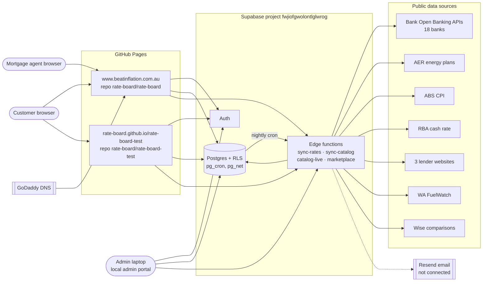
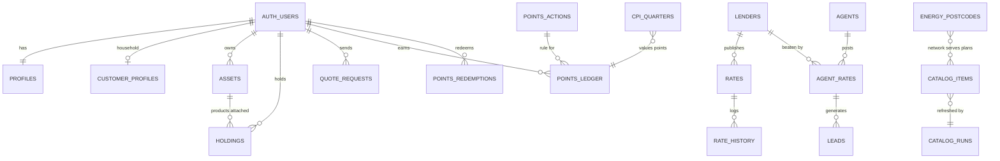

# Architecture

| Document | ARC |
| --- | --- |
| Version | 1.0 |
| Last updated | 26 Oct 2026 |

A static website on GitHub Pages talks directly to Supabase (Postgres with row-level security, Auth and edge
functions). Scheduled database jobs call edge functions that pull public data feeds into the catalogue every night.
There is no other server.

## ARC-01 System context



## ARC-02 Components

| ID | Component | Technology | Responsibility | Code |
| --- | --- | --- | --- | --- |
| `ARC-02.1` | Home loan board | Static HTML/JS | Rate board, agent rates, sign-in, profile | `index.html`, `common.js`, `common.css` |
| `ARC-02.2` | Super-app pages | Static HTML/JS | Product hub, comparisons, My money, calculators | `products.html`, `compare.html`, `my-money.html`, `calculators.html`, `app.js`, `catalog.js`, `app.css` |
| `ARC-02.3` | Agent portal | Static HTML/JS | Agent sign-up, rates, leads | `agent.html` |
| `ARC-02.4` | Admin portal | Local HTML file (private repo) | Approve agents, view leads, operations | `rate-board-admin/index.html` |
| `ARC-02.5` | `sync-rates` | Deno edge function | Home loan rates (Open Banking + scrapers), RBA cash rate | `supabase/functions/sync-rates` |
| `ARC-02.6` | `sync-catalog` | Deno edge function | Catalogue: banking, loans, energy plan lists, CPI | `supabase/functions/sync-catalog` |
| `ARC-02.7` | `catalog-live` | Deno edge function | Fuel, money transfers, energy bill estimates | `supabase/functions/catalog-live` |
| `ARC-02.8` | `marketplace` | Deno edge function | Email sending, agent invites, account deletion | `supabase/functions/marketplace` |
| `ARC-02.9` | Database | Postgres | Data, row-level security, points and marketplace logic | `supabase/migrations` |

## ARC-03 Data model



| Table | Holds | Who can read |
| --- | --- | --- |
| `catalog_items` | Every product beyond home loans (category, provider, rate, attributes, source) | Everyone |
| `catalog_runs`, `sync_runs` | Sync job results | Admins |
| `energy_postcodes` | Postcode → electricity network | Everyone |
| `energy_plan_cache` | AER plan details, 3 days | Edge functions only |
| `cpi_quarters` | ABS CPI index by quarter | Everyone |
| `customer_profiles`, `assets`, `holdings` | Customer's household, assets, products held | The customer |
| `quote_requests` | Insurance and broker requests | The customer; admins |
| `points_actions` | Earning rules | Everyone |
| `points_ledger`, `points_redemptions` | Points entries and payouts | The customer; admins |
| `lenders`, `products`, `rates`, `rate_history`, `rba_cash_rate` | Home loan board | Rates: signed-in users (preview function for signed-out) |
| `agents`, `agent_rates`, `leads`, `email_outbox` | Agent marketplace | Per marketplace rules |

## ARC-04 Nightly data flow

```mermaid
sequenceDiagram
  participant cron as pg_cron
  participant fn as sync-catalog
  participant src as Banks / AER / ABS
  participant db as Postgres
  cron->>fn: POST ?job=banking (anon key)
  fn->>db: insert catalog_runs (running)
  fn->>src: list products, then each product's detail
  src-->>fn: product data
  fn->>db: upsert catalog_items; retire products no longer published
  fn->>db: update catalog_runs (ok / partial / failed + summary)
```

## ARC-05 Security model

- The browser holds only public keys (publishable key and anon JWT). Every table has row-level security; customers
  read and write only their own rows (BR-101).
- Points can't be written by customers directly: only through `award_points` (self-service actions with limits) and
  `redeem_points`, which run with database privileges and check the rules.
- New edge functions keep **Verify JWT** on; the nightly jobs and the site send the public anon key.
- The admin portal requires two-factor sign-in and is never hosted online.
- Secrets (service role key, email API key) live only in Supabase's secret store. See [CREDENTIALS.md](CREDENTIALS.md).
