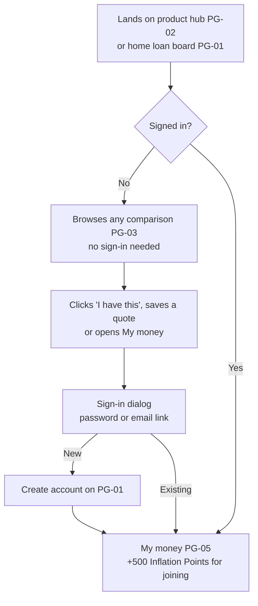
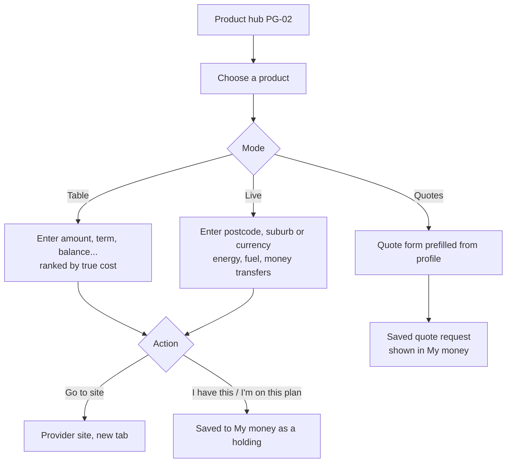
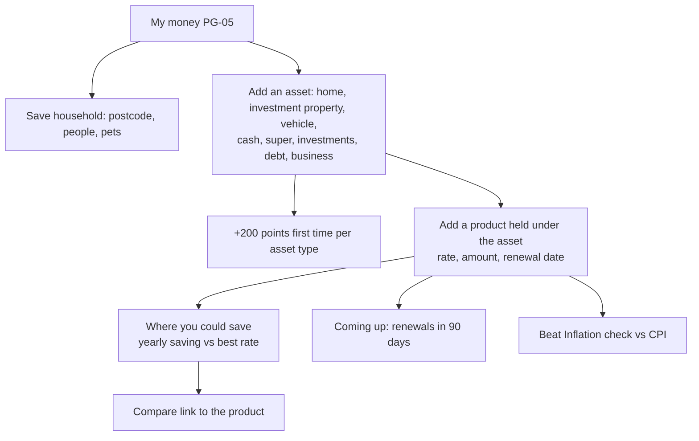
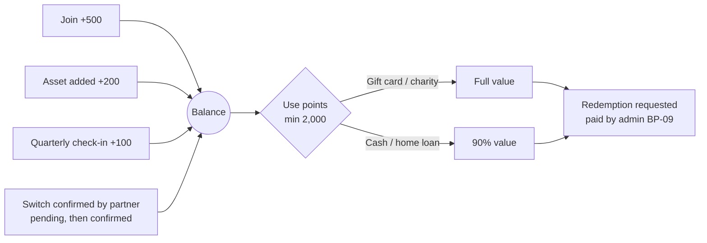
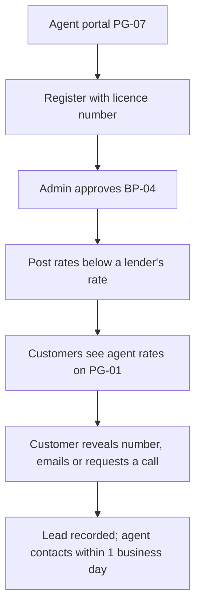
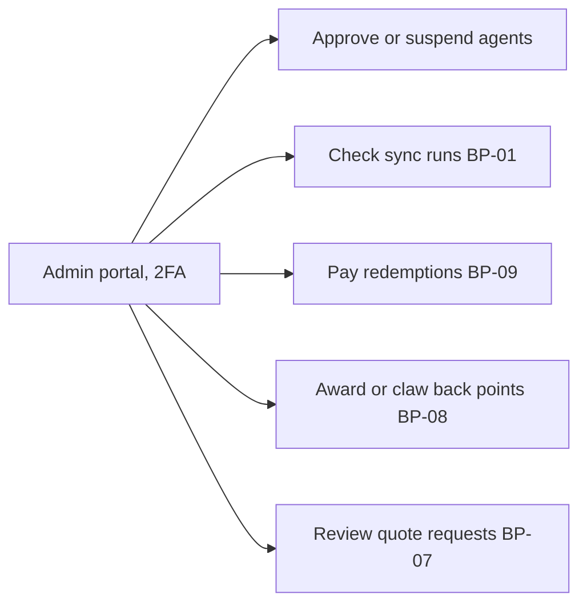

# Experience flows

| Document | FLW |
| --- | --- |
| Version | 1.0 |
| Last updated | 26 Oct 2026 |

How customers, agents and the admin move through the product. Screens are referenced by their page ID in
[design/](design/README.md).

## FLW-01 First visit to sign-up

## FLW-02 Compare and save a product

## FLW-03 Build the money profile

## FLW-04 Earn and use Inflation Points

## FLW-05 Energy plan comparison

```mermaid
flowchart TD
  a[Energy PG-03e] --> b[Postcode prefilled from profile]
  b --> c[People at home sets kWh; solar export optional]
  c --> d[Compare plans]
  d --> e[Edge function finds networks for the postcode,<br/>prices up to 10 plans per retailer]
  e --> f[Table: yearly bill, supply, usage, feed-in,<br/>conditional discounts]
  f --> g[Plan details on Energy Made Easy] & h[I'm on this plan → My money]
```

## FLW-06 Mortgage agent (existing)

## FLW-07 Admin operations

Agent approval is in the admin portal today. The other four steps run in the Supabase SQL editor until admin portal
screens are added (`CAP-17`).

